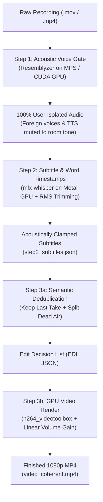

# AI Talking-Head Auto-Editor

An automated 3-step video editing skill for solo talking-head recordings. 

Designed for creators who rehearse sentences multiple times, check phone dictionaries/translators mid-take, and want an export-ready 1080p MP4 without requiring manual NLE cutting (Premiere, Final Cut) or paid cloud tools (CapCut Pro).



---

## Key Features

1. **Pre-Whisper Voice Gate & Auto-Enrollment (Step 1)**:
   - Uses a 256-dim speaker d-vector (`Resemblyzer`) evaluated against WebRTC VAD islands + `0.8s` sliding sub-windows.
   - **Zero-Config Auto-Enrollment**: Automatically builds and saves the speaker's permanent voice fingerprint from their 8 longest monologue islands ($\ge 3.5\text{s}$) on the very first run.
   - Surgically mutes Google Translate pronunciations, phone notification chimes, and background speakers.
2. **GPU Subtitles & Acoustic Alignment (Step 2)**:
   - Runs `mlx-whisper` on Apple Silicon Metal GPU (~100x realtime).
   - **Local Island Recovery**: Cross-checks physical voice islands and locally re-transcribes skipped speech or low-diversity hallucination loops.
   - **Acoustic Word Trimmer**: Inspects 20ms RMS envelopes to strip leading/trailing silence and automatically split collapsed in-island stutters.
3. **Semantic Deduplication & Fast GPU Export (Step 3)**:
   - Always keeps the **last complete take** across repeated phrases.
   - Preserves natural human breathing pauses (`0.25s–0.35s`) at sentence boundaries with `0.015s` audio micro-fades.
   - Renders 4x parallel chunks via `h264_videotoolbox` hardware acceleration.
   - Applies pure constant linear gain (`volume=+XdB`) with zero FFT denoising or dynamic AGC pumping, keeping the voice natural and comfortable.

---

## Hardware & Acceleration Table

| Stage | Task | Hardware / Tool | Performance |
| :--- | :--- | :--- | :--- |
| **Step 1** | Voice Gate & TTS Removal | PyTorch MPS GPU (`resemblyzer` + `webrtcvad`) | ~10s for 20-min video |
| **Step 2** | Whisper Subtitles & Alignment | Apple Silicon Metal GPU (`mlx-whisper`) | ~30s for 20-min video |
| **Step 3a** | Narrative Deduplication | LLM Agent (`pro` / `inherit`) | Token-efficient (~3k tokens) |
| **Step 3b** | Video Render & Gain Adjustment | Apple Silicon Media Engine (`h264_videotoolbox`) | ~35s for 20-min 1080p video |

---

## Installation

### Prerequisites
- macOS (Apple Silicon M1/M2/M3/M4 recommended)
- `ffmpeg` installed (`brew install ffmpeg`)
- Python 3.10+
- [`uv`](https://github.com/astral-sh/uv) package runner (`brew install uv` or `curl -LsSf https://astral.sh/uv/install.sh | sh`)

### Setup as an Antigravity Skill
Clone the repository and run the install script:

```bash
git clone https://github.com/YOUR_USERNAME/ai-talking-head-editor.git
cd ai-talking-head-editor
./install.sh
```

This creates a symlink at `~/.gemini/config/skills/ai-talking-head-editor`, making the skill available inside Google Antigravity (`agy`).

---

## Usage

### 1. In Antigravity CLI / IDE
Simply ask Antigravity:
```text
Use ai-talking-head-editor to edit /path/to/my_recording.mov
```

### 2. Manual Terminal Commands

#### Step 1: Voice Gate & Non-User Sound Removal
```bash
uv run --with "resemblyzer" python3 scripts/step1_voice_gate.py input_video.mov audio_work
```
*Optional: Explicitly re-enroll a voice profile:*
```bash
uv run --with "resemblyzer" python3 scripts/step1_voice_gate.py --enroll sample_voice.wav
```

#### Step 2: Subtitle & Word Timestamp Extraction
```bash
python3 scripts/step2_transcribe.py audio_work mlx-community/whisper-small-mlx
```

#### Step 3: Render Final Video from EDL
```bash
python3 scripts/step3_render_mp4.py audio_work/step3_final_edl.json input_video.mov output_clean.mp4 audio_work
```

---

## Repository Structure

```text
ai-talking-head-editor/
├── README.md               # Documentation & usage guide
├── SKILL.md                # Antigravity agent skill definition
├── LICENSE                 # MIT License
├── .gitignore              # Ignores large media and personal voice embeddings
├── install.sh              # 1-line installation script
├── scripts/
│   ├── step1_voice_gate.py # MPS GPU voice gate + auto voice enrollment
│   ├── step2_transcribe.py # mlx-whisper GPU transcription + RMS trimming
│   └── step3_render_mp4.py # 4x VideoToolbox GPU rendering + linear gain
└── resources/
    └── .gitkeep            # Directory for local my_voice_profile.npy
```

---

## License
MIT License. See [LICENSE](LICENSE) for details.
